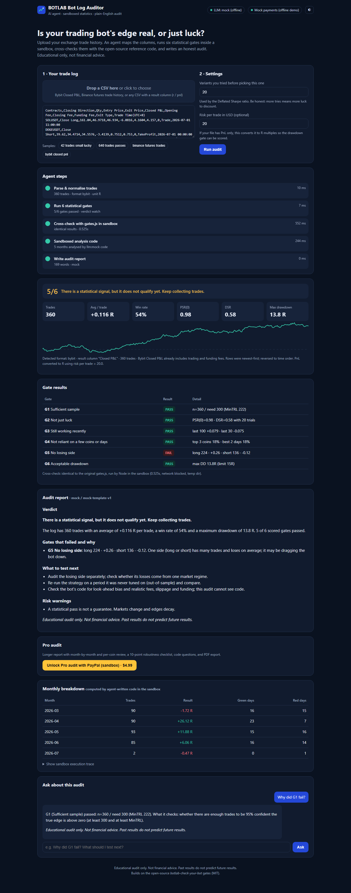

# BOTLAB Bot Log Auditor

An AI agent that audits a trading bot's real trade history. Upload an exchange CSV and the agent
maps the columns, runs six statistical gates inside a code sandbox, cross-checks them against the
open-source reference implementation, has the LLM write and run its own analysis code in the
sandbox, and then writes an honest, plain-English audit report you can ask follow-up questions about.
The paid "Pro audit" (PayPal Sandbox) adds a longer report and a PDF export.

> Educational tool. Not financial advice. It never tells you to trade, and it never promises profits.

**Live demo:** https://botlab-auditor.botsite.workers.dev · **Video (2:45):** https://youtu.be/oQc5DGtB8RY

## Built and operated by AI

BOTLAB is a one-founder project that is **run day to day by AI agents**. Claude-based agents write and
test the code (including this auditor), run the strategy research and backtests, operate the
paper-trading bots, monitor the live bots, and draft reports and posts. The human founder sets the
direction and approves every action that involves real money, accounts, publishing or production
changes. This repository was built the same way: the founder decided the scope; AI agents wrote the
code, the tests and the docs.

## How PayPal and AI are used (PayPal AI Hackathon)

| Tool | Where | What it does |
|---|---|---|
| **PayPal JavaScript SDK** (sandbox) | `worker/public/app.js`, `worker/src/paypal.js` | Renders PayPal checkout buttons that unlock the Pro audit for USD 4.99 of sandbox (test) money. The hosted demo uses the public sandbox client id `sb` (order created and captured in the browser, then verified by the Worker). |
| **PayPal Orders v2 REST API** (sandbox) | `worker/src/paypal.js`, `payments_paypal.py` | Server-side create order → buyer approves → server capture → Pro unlocked. Active when `PAYPAL_CLIENT_ID` / `PAYPAL_CLIENT_SECRET` sandbox secrets are set (`npx wrangler secret put …`). |
| **Cloudflare Workers AI – Llama 3.3 70B Instruct** | `worker/src/report.js` | Writes the plain-English audit (verdict, failed gates and why, what to test next, risk warnings) and answers follow-up questions, grounded in the gate numbers. Falls back to a deterministic template if the model errors or drifts into advice. |
| **Python agent + sandbox** (any LLM: Anthropic or OpenAI-compatible) | `agent.py`, `sandbox.py`, `llm.py` | Full agent version: the LLM maps unknown CSV columns and writes analysis code that runs in a restricted sandbox (no network, no subprocess, temp dir, timeout). |
| **PayPal Orders v2 for AI agents** (agentic commerce) | `worker/src/app.js` (`/api/agent/*`), `agent_buyer.py` | Another AI agent (e.g. a trading bot) discovers the service (`/api/agent/manifest`), gets a free gate summary and a PayPal order within its budget (`/api/agent/quote`), its human owner approves the spend on PayPal, then the agent captures and collects the Pro audit (`/api/agent/fulfil`). |
| **PayPal Webhooks** (sandbox) | `worker/src/paypal.js` `verifyWebhook`, `/api/paypal/webhook` | `PAYMENT.CAPTURE.COMPLETED` events are signature-verified with PayPal (`verify-webhook-signature`) and stored as receipts. |
| **Receipts** | `/api/receipt?order_id=` | Order id, capture id, amount and the input fingerprint (never the CSV), from the optional `RECEIPTS` KV or looked up live from PayPal, so a paid audit can always be re-issued. |
| **AG Grid Community** (MIT) | `worker/public/vendor/`, `worker/public/app.js` | Sortable, filterable month-by-month (green/red days) and per-coin grids in the Pro audit; plain tables are kept for print/PDF. |
| **Cloudflare Workers** | `worker/` | Stateless hosting; uploaded files are processed in memory and never stored. |

Setup: hosted version → see [`worker/README.md`](worker/README.md) (`npm install`, `npx wrangler deploy`); Python version → [Run locally](#run-locally) below.



## Agentic commerce: an AI agent buys an audit

Trading bots are increasingly run by AI agents. Before an agent risks money on a strategy, it should
buy an independent check of that strategy, and a human should approve the spend. The flow:

```
agent  --GET  /api/agent/manifest-->  service, price, flow, policy
agent  --POST /api/agent/quote  -->  free 6-gate summary + offer (4.99 USD) + PayPal order {order_id, approve_url}
                                      (refused with 402 if the price is above the agent's max_price_usd)
human  --approves approve_url on PayPal (sandbox)-->  return page /paid.html
agent  --POST /api/agent/fulfil -->  202 awaiting_approval ... then: server captures, verifies the order is bound
                                      to this exact file (custom_id = SHA-256 fingerprint) -> {receipt, Pro audit}
```

Try it (standard library only):

```bash
python agent_buyer.py --api https://botlab-auditor.botsite.workers.dev \
  --csv samples/synthetic_42_trades_small_lucky.csv --agent fastbot-5m --max-price 5
```

The agent prints the PayPal approve link, waits for the approval, collects the Pro audit and, if the
edge is not proven, recommends pausing the book. On a deployment without PayPal keys and with
`PAYPAL_MODE=mock`, the order is simulated so the flow can be tried offline.

**For judges (sandbox only, test money):** log in on the PayPal checkout with the sandbox buyer
account `<sandbox buyer email>` / `<sandbox buyer password>` (a PayPal Developer test account, not a
real one).

## The problem

Most retail trading bots that look profitable aren't. They were tested on 40 trades, tuned across 50
variants, carried by one coin or one lucky day, or they stopped working months ago. Exchange
dashboards show PnL. They don't tell you whether that PnL could be luck. Statistics like the
Deflated Sharpe Ratio and Minimum Track Record Length answer that question, but few traders can
compute or read them. This project turns those statistics into a short audit that anyone can read.

## How it works

```
 Browser (static/index.html)
   | upload / paste CSV, trials, risk per trade
   v
 app.py  (stdlib http.server, JSON API, in-memory jobs, progress polling)
   |
   v
 agent.py  ── step 1  csv_normalize.py   Bybit / Binance / generic column mapping
   |                                     (LLM proposes a mapping only if the heuristics fail)
   |          step 2  gates.py           six gates, a Python port of gates.js
   |          step 3  sandbox.py ──────> node vendor/gates.js   (original code, cross-check)
   |          step 4  llm.py   writes Python analysis code ──> sandbox.py (python -I -S)
   |                           (built-in script used if the generated code fails)
   |          step 5  llm.py   writes the report from computed FACTS only
   v
 llm.py  providers: anthropic | openai_compatible (Vultr Serverless Inference) | mock (offline)
 payments_paypal.py  PayPal REST v2 Orders, sandbox only: create -> approve -> capture -> unlock Pro
 pdf_export.py       dependency-free PDF of the Pro report
```

**Sandbox (`sandbox.py`).** Every piece of executed code runs as a separate process:
- in a fresh temp directory that is deleted afterwards
- with a stripped environment, so no API keys or PayPal secrets
- under a hard timeout that kills the process tree
- with stdout/stderr capped
- with the network disabled

Python runs isolated (`-I -S -B`) behind a prelude that blocks sockets, subprocess, ctypes and file
access outside the work dir. Node runs under the permission model (`--permission`, fs read limited to
the temp dir, no child processes) with a preload that stubs net/http/https/dns/fetch. On Linux, rlimits
also cap memory, CPU, open files and file size. This is defence in depth for a demo. A public
deployment should also run the app in a container or microVM.

**The six gates** (from botlab-check-your-bot): G1 sample size vs MinTRL, G2 PSR/DSR (luck after N
trials), G3 still working recently, G4 not reliant on a few coins or days, G5 no losing side, and
G6 drawdown under 15R.

## Run locally

```bash
pip install -r requirements.txt   # only pytest; the app itself is standard library
python app.py                     # http://127.0.0.1:8000
python -m pytest -q               # tests
```

Python 3.10+ is required. Node.js 18+ is optional: it's needed for the sandboxed gates.js cross-check,
and that step is skipped if Node isn't installed. With no environment variables set, the app runs fully
offline with the **mock** LLM and payments disabled. Try the samples in `samples/`, which are all
synthetic.

## Environment variables

The app does not read `.env` files. Export the variables in your shell. `.env.example` lists them all.

| Variable | Purpose |
|---|---|
| `LLM_PROVIDER` | `mock`, `anthropic` or `openai_compatible`. Auto-detected if unset |
| `ANTHROPIC_API_KEY` | Anthropic key. The model defaults to `claude-sonnet-5-5` |
| `LLM_BASE_URL`, `LLM_API_KEY`, `LLM_MODEL` | Any OpenAI-compatible endpoint, e.g. Vultr Serverless Inference `https://api.vultrinference.com/v1` |
| `PAYPAL_CLIENT_ID`, `PAYPAL_CLIENT_SECRET` | PayPal Developer **sandbox** REST app credentials |
| `PAYPAL_MODE` | `sandbox` (the default when keys are set), `mock` (offline demo of the flow) or `disabled` |
| `PRO_PRICE_USD` | Default `4.99` |
| `PUBLIC_BASE_URL` | Base URL PayPal redirects back to (default `http://127.0.0.1:8000`) |
| `HOST`, `PORT` | Default `127.0.0.1:8000` |

Keys are read only from the environment. They are never logged, never returned to the browser and
never passed to sandboxed code.

## New vs reused

**Reused**, from [botlab-check-your-bot](../github_repo) (MIT, (c) 2026 BOTLAB):
- `vendor/gates.js`, copied unchanged
- the two `samples/synthetic_42_*` and `synthetic_640_*` example CSVs

This project builds on botlab-check-your-bot.

**New for this project** (written October–November 2026, i.e. inside the PayPal AI Hackathon
submission period that began 1 Oct 2026):
- `gates.py`, a numerically identical Python port (verified against gates.js in tests)
- the agent pipeline
- exchange CSV normalisation (Bybit, Binance, generic, LLM fallback)
- the sandbox
- the LLM provider layer and report and chat prompts
- PayPal Sandbox payments
- the PDF export
- the web UI
- the synthetic exchange samples
- agentic commerce (`/api/agent/*`, `agent_buyer.py`), PayPal webhooks, receipts, AG Grid tables (24 Oct 2026)
- the tests

## Tests

`python -m pytest -q` runs 49 Python tests, and `cd worker && npm test` runs 35 Worker tests (including the
agent quote/approve/capture flow, budget guard, file binding, webhook signature check and receipts, all with
mocked PayPal). The Python tests cover:
- parsing variants
- parity with gates.js on the example CSVs and the normalised exchange exports
- sandbox timeout, network, fs, subprocess and env isolation
- the mock report, determinism, and fallbacks
- Anthropic and OpenAI-compatible request shapes (mocked HTTP)
- the PayPal create/capture flow (mocked HTTP), sandbox-only enforcement, and the PDF

## Limitations and disclaimer

The auditor sees trades, not code. It cannot detect look-ahead bias, unrealistic fills or wrong cost
modelling. A passing audit is not evidence that a strategy will keep working. This software is for
education. It is not investment advice, and nothing in it is a recommendation to buy or sell anything.
Past results do not predict future results.

## License

MIT, (c) 2026 BOTLAB. See `LICENSE`.
